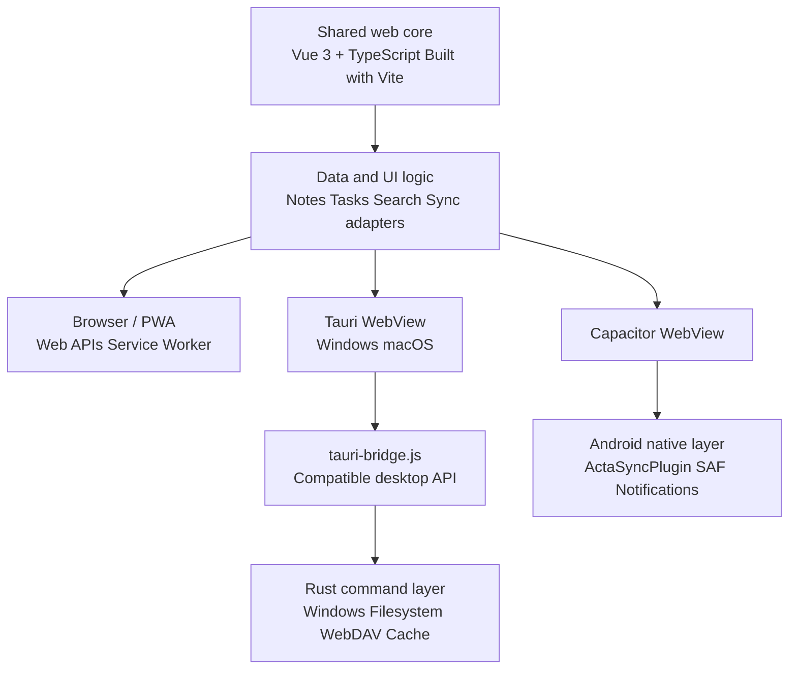

<p align="right">
  <a href="./README.md">简体中文</a> <strong>English</strong>
</p>

<p align="center">
  
</p>

<p align="center">
  <strong>Current version v4.2.0</strong>
</p>

Acta is a local-first notes and tasks app that brings writing, action, and organization into one calm workspace. The project shares a single web interface across Tauri desktop apps for Windows/macOS, a Capacitor Android app, and a modern-browser PWA.


## Features

- Bidirectional links between notes and tasks, with navigation and unlinking from either editor
- High, medium, and low task priorities, plus subtasks, progress, immutable creation time, and optional start/due times
- Check-in tasks: generate from the create menu or quick capture, check in daily with streak/total counters and a last-7-days strip, optional start/due dates that feed the calendar, and a today badge on list cards
- Ordered subtasks: turn on "In order" to arrange subtasks by number and reorder them with arrow buttons; the default stays unordered
- Bulk subtask add & export: the editor's progress row offers "Quick-add subtasks" (one per line — paste a multi-line list and append them all at once) and "Export subtasks" (plain lines or a Markdown task list, copied to the clipboard or saved as a TXT / Markdown file); exports can include or exclude completed subtasks, and each line can be prefixed with a numbering style of your choice (none, `1.`, `1、`, `一、`, or `(1)`)
- Find inside the task & note editors: `Ctrl/⌘+F` or the find button in the editor toolbar opens a floating find bar — all matches highlight live via the CSS Highlight API (the body text is never rewritten), a current/total counter tracks progress, Enter / Shift+Enter or the buttons jump between matches, and Esc closes; the scope covers note bodies, task descriptions, and every subtask, while Markdown source mode locates matches via the selection
- Ordered subtasks can be reordered with arrow buttons or by dragging the leading number (checking a step auto-completes earlier unchecked ones); subtasks record their completion time and show the date next to the checkbox (hover for the exact timestamp, toggleable in settings), and the completed group can switch between oldest-first and newest-first ordering; in unordered mode a checked row lingers briefly, then slides into — or fades into — the bottom collapsed group (sharing the delay setting with the list); clicking "Add a subtask" focuses the new row and smoothly centers it in view, and ↑/↓ move the caret between neighboring subtasks while editing; folder views offer a "Show completed" switch; completed tasks wait a moment before settling (delay and switch configurable in task settings), leaving time to undo: where completed items stay visible they glide to the end of the list with a fluid, non-linear motion, and in views like the inbox they fade out after the pause
- An action history dialog in the lower-left dock lists recent operations (creation, deletion, completion, check-ins, subtask changes, classifications — up to 500 entries); entries about a specific item restore that item to the state before the action after an inline confirmation; data statistics moved into the workspace settings page; deleting a subtask requires a two-step inline confirmation
- A year/month/week/day calendar replacing Today: week numbers in the compact month view, independently scrollable desktop/mobile week layouts, and direct task/subtask completion in week and day views; tap the current-period label for a quick jump — year stepping plus a twelve-month grid, tap to land
- A plan board page: a modular canvas you compose yourself — task/note reference cards (corner-drag to resize, with per-card opacity and shown-content toggles — type pill, priority, date, preview, and footer each switchable), rich text (numeric font size, four fonts plus custom, bold/italic, a cycling alignment button, text color with six swatches plus a picker, and a background panel with fill / opacity plus stepless radius / padding sliders), and markers (arrow / box / ellipse / line with six swatches plus a color picker and adjustable stroke width; arrow heads and tails are set independently — none / arrow / dot / bar, ellipses take a fill color plus fill and stroke opacity; freehand is a modal continuous tool — pen / highlighter / eraser brushes in one panel with size, opacity, flow, tip shape (round / flat / square), and color, the eraser wiping whole strokes by radius) arrange freely, with positions saved and synced inside the Acta data (boards live in the data folder as `boards/`, so they survive upgrades and portable-exe replacements); a layers panel (button left of the customize button) lists every element in z-order with click-to-select and eye toggles for visibility, each freehand session groups its strokes automatically, and marquee selections combine with Ctrl/⌘+G and split apart with Ctrl/⌘+Shift+G; in a multi-selection the resize handles collapse onto the overall bounding box — eight handles (four corners plus edge midpoints) scale the whole group in place, cards / text / markers and strokes deform together with a minimum-size guard for cards, and the scaling is undoable; create, switch, rename, and delete as many boards as you like — the board selector sits right of the plan-board title; each board is personalizable — background pattern (dots / grid / none), background color, snap-to-grid, and pattern grid size, saved with the board (the customize button sits top-right of the canvas); drag on empty canvas to marquee-select components (drag any selected one to move the group, multi-delete), hold Space to pan temporarily, and middle-drag anytime; canvas actions undo / redo (toolbar and Ctrl/⌘+Z); deletions use a tap-again confirmation; the import dialog filters by type, classification, and search to multi-select items (unticking removes them), and each card has its own hover-remove control; linked tasks and notes on the same board stay joined by a following dashed bezier curve (can be turned off in settings); tapping a card opens the floating editor panel (width-draggable, its close button and resizer sliding along with the panel, auto-focusing the selection and restoring the previous viewport on close), the wheel / pinch zooms, pseudo-infinite panning rebounds with rubber-bands and no momentum, with virtualized rendering whose margin is adjustable in settings — per-board viewports are remembered; on mobile the canvas owns the gestures in the center pane, so dragging the render area pans the canvas without moving the page or bouncing the list, the floating toolbar sits just above the bottom bar, and the marker menu opens as its own layer instead of being clipped by the toolbar's horizontal scroll; plan-board image / PDF export starts with an on-canvas area selection (the default frame contains every element with equal margins, auto-centered; drag the frame or handles to adjust, or jump back to all elements / current view), then asks the system for a location and file name on both desktop and Android (.actaplan / PNG / JPG / PDF)
- A summary page (formerly statistics) as a notes-and-tasks list: gather items created in a chosen period, list every subtask in full, tick some, and make a list picture in one click; a "Data statistics" dialog in the sidebar's lower-left dock reports the profile's total file size, file count, notes, tasks, classifications, and trash count
- A note base font-size slider that scales body text and every heading level together; heading size and heading font remain independently adjustable (serif, rounded, monospace, or a custom font), with separate sliders for in-paragraph line spacing and paragraph spacing; Markdown syntax typed in the visual editor (headings, lists, quotes, bold/italic, and more) applies instantly
- First-run OOBE onboarding: set the software data folder, theme and interface font, and launch animation step by step; it can be re-run from general settings, and the software data location can be changed later. On the web and mobile there is no file system, so the first step is ready from the start (settings stay on-device) instead of waiting for a folder. App-icon switching is an Android-only feature with four built-in presets (desktop builds always use the bundled default icon)
- MWS Light / MWS Dark brand themes (primary #FF6666, secondary #66CC66; the light theme paints the sidebar and titlebar in the brand colors) plus three previewable launch animations with a playback-speed control
- Deleting offers move-to-trash or delete-now; the trash is never emptied automatically and supports restore, delete-forever, and empty-all
- Folders, smart views, combinable task/note filters, and unified search; on mobile, the chevron beside the Inbox title opens a switcher with Inbox pinned first, so you can jump back to Inbox from any classification; a folder can be given a custom Emoji icon and color right in the create dialog (six presets plus a color picker); with the sidebar collapsed each folder is just its color circle (the rounded plate is gone) and the selected one is ringed in its own color; a folder page shows that folder's Emoji beside the title at 50% opacity over a soft glow of the same color
- Customizable navigation bar: page buttons in the desktop sidebar and mobile bottom bar can be toggled freely and independently of each other (All tasks and All notes are hidden by default and can be re-enabled in settings; the two right-hand slots of the mobile bottom bar can be swapped for any remaining page, while the outer two stay fixed to Inbox and Calendar, and pages already in use are excluded from the menus; the two slots follow the configured left-to-right order, and every combination keeps all four entries on the same row)
- Rich-text editing and UTF-8 Markdown import/export for individual notes
- A desktop context menu on an opaque panel, with cut, copy, paste, and select all for text, plus copy for any selected text
- Window dragging on desktop: the titlebar and the focus-mode header both move the window, and while any secondary dialog is open the titlebar strip at the top of the viewport and the dialog's own header drag the window too; double-click maximizes or restores. On desktop the settings page fills the whole window (no dimmed backdrop or margins), with Windows minimize/maximize buttons built into the settings header
- Simplified Chinese, Traditional Chinese, and English interfaces with theme and font settings
- All dropdown menus, scrollbars, sliders, date-time pickers (numeric input or a Material You-style clock dial, switchable any time), and settings toggles are custom-drawn controls; hover feedback uses scale instead of shifting, keeping motion restrained and smooth
- Compact mobile top chrome: the titlebar, page header, and settings header are each 48px (system safe-area insets are still fully respected), the search field moves up with them so content enters the viewport sooner, and the version chip is hidden below 360px so it never collides with the top-right actions
- Local data folders, WebDAV, and Acta LAN sync: desktop and Android clients can automatically discover other Acta devices on the same network and exchange complete data folders directly. Acta LAN sync is its own page (Data sync in settings keeps only an "Open LAN sync" entry, and the mobile titlebar shortcut plus the sidebar radar entry open it directly; the desktop dialog widens to 880px, and on Android the page always fills the screen), with "Be discoverable" pinned first — this device sits at the center with a circular ripple, nearby devices fade in as bubbles, and tapping a bubble sends or imports data. This device's name, emoji avatar, and service port can be customized on desktop and Android alike, and discovery broadcasts, the radar, and sync requests all use the same identity; both sides can pick the exact data profiles involved, and choose between replacing a specific profile or copying the data in as a new one; pushes use two-stage confirmation (the other device first gets a notification, then a detailed consent dialog), and devices with "Trust this network" enabled confirm automatically; transfers show per-step progress, and a restorable backup is created automatically before anything is overwritten. Sync automations combine automatic backups, conflict checks, and transfers into entries that run when a device is found, on a schedule, or manually
- Desktop can keep running in the background: closing the window keeps Acta in the system tray so LAN discovery and sync automations continue; restore the window from the tray or Dock icon
- Android predictive back: the page keeps shrinking as you drag, and on commit it collapses and fades out instead of snapping back — the destination is swapped in while the surface is invisible and then fades in to settle, one pair of motions shared by view switches (folder / all tasks / calendar → Inbox), immersive note editing, settings, and every overlay, with no layer replaying its own close animation; back without a gesture (Android 13 commit callback, hardware back key) runs the same pair and can be turned off in general settings. The amplitude slider has two clearly different bands at 100% / 200% (whole page shrinks 14% / 30%), the corner radius grows to 32px while dragging and fills to 42px on commit with an eased rebound, and the settings backdrop turns transparent while dragging so the workspace shows underneath
- Android local notifications, system file pickers, and Storage Access Framework integration
- Installable PWA support with offline caching

## Quick start

Web development only needs Node.js 22+ and npm; desktop development additionally requires Rust stable and the Tauri system dependencies for the host platform.

```bash
npm install
npm run dev        # Vite dev server, open http://localhost:5173
npm start          # Tauri desktop app (starts the Vite dev server automatically)
```

Common commands:

| Command | Purpose |
| --- | --- |
| `npm run dev` | Start the Vite dev server for web development |
| `npm run build` | Build the shared web assets into `dist/` |
| `npm run preview` | Preview the built output locally |
| `npm run typecheck` | Run strict type checking via vue-tsc |
| `npm start` | Start the Tauri desktop app |
| `npm test` | Run the headless smoke test through a Vite dev server (local Edge/Chrome) |
| `npm run desktop:build` | Build the desktop app for the current platform (runs `vite build` first) |
| `npm run windows:build` | Build the Windows x64 NSIS installer |
| `npm run macos:build` | Build an Apple Silicon (aarch64) macOS App and DMG on macOS |
| `npm run build:pages` | Build the PWA site into `docs/` (GitHub Pages) |
| `npm run android:sync` | Build the web assets and sync them into the Android project |
| `npm run android:build` | Sync assets and build an Android debug APK |

Android builds require JDK 21, Android SDK 36, and Node.js 22 (Capacitor 8 requirements). The debug APK is generated at `android/app/build/outputs/apk/debug/app-debug.apk` and is not committed to the source repository.

## Architecture

Acta follows a “shared web core + platform adapters” design. Notes, tasks, views, and most synchronization logic have a single implementation. Platform layers only provide system capabilities such as windows, file pickers, directory access, network proxying, and notifications.



### Repository layout

The web app uses Vite 8 + Vue 3 + TypeScript: the root `index.html` is the Vite entry (SVG icon sprite + the `#app` mount point), the entire application shell is the template of `src/App.vue`, mounted by `src/main.ts`. The existing business modules keep their original form and are booted in the original script order by `src/boot.ts`; `public/legacy/renderer.js` stays a classic script because it exports page-level global bindings (`library`, `settings`, `renderAll`, …) and serves as the shared data layer. New code should live under `src/` (Vue SFCs or TypeScript), gradually replacing modules in `src/legacy/`.

| Path | Responsibility |
| --- | --- |
| `index.html` | Vite entry page: inline scripts, icon sprite, and the mount point |
| `src/` | Vue 3 + TypeScript app source: `App.vue` shell template, `main.ts` / `boot.ts` boot chain, shared styles |
| `src/legacy/` | Existing business modules (loaded as ES modules, files unchanged) |
| `public/` | Static assets copied verbatim: `legacy/renderer.js`, vendor libraries, icons, manifest, service worker, theme-boot |
| `dist/` | `vite build` output (the input for Capacitor `webDir` and Tauri `frontendDist`, not committed) |
| `src-tauri/` | Tauri 2 configuration, Rust commands, desktop permissions, and Windows/macOS icons |
| `android/` | Capacitor Android project and the native `ActaSyncPlugin` file bridge (Capacitor config: `capacitor.config.ts` at the repository root) |
| `scripts/` | Headless-browser smoke tests, preview screenshots, and Android icon generation |

### Platform build configuration

The desktop build merges a platform-specific config over the shared base. Platform-dedicated files are marked separately below:

| File | Platform | Notes |
| --- | --- | --- |
| `src-tauri/tauri.conf.json` | Shared base | Product name, identifier, icons, and other shared settings |
| `src-tauri/tauri.macos.conf.json` | **macOS only** | Overlay title bar with traffic-light position, macOS 10.13 minimum, `.app` and `.dmg` bundles |
| `src-tauri/tauri.windows.conf.json` | **Windows only** | NSIS installer, WebView2 bootstrapper, and installer language selector |

The macOS build targets Apple Silicon (`aarch64-apple-darwin`), set by the `macos:build` script in `package.json`. For Intel or universal binaries, switch the target to `x86_64-apple-darwin` or `universal-apple-darwin`.

### Continuous integration

Builds run automatically through GitHub Actions (`.github/workflows/build.yml`): every push to `main` and every `v*` tag triggers a build of the Windows portable exe, macOS DMG, and Android APK, with artifacts attached to the workflow run. `v*` tag builds are additionally published as a GitHub Release; consecutive pushes to the same branch cancel the previous unfinished build.

### Data and synchronization

- Core data stays on the device by default; browser settings use `localStorage`, while directory handles use IndexedDB. Since v3.0.0 the desktop app keeps its software data next to the program by default (the `data` folder beside the exe), or in a location you choose, mirrored into `settings.json` there so it survives cache clears.
- A data folder contains `acta-manifest.json`, `classifications.json`, `boards/`, `notes/`, and `todos/`, with each note, task, and plan board stored separately. Since v4.2.0 every plan board lives in its own file (`boards/board-<id>.json`, carried through backups, LAN sync, and cross-device restores); folders written by v4 or earlier are upgraded to v5 on first read — boards migrate into per-board files and the legacy `boards.json` is removed — so replacing a portable build no longer loses boards.
- Tauri uses restricted Rust commands for system files, WebDAV, LAN sync, and cache management; Android uses a custom Capacitor plugin and the Storage Access Framework for user-authorized directories, with LAN sync implemented natively in the ActaLan plugin using the same protocol v2; the Android app is portrait-only.
- WebDAV credentials are used only for the server configured by the user. LAN sync runs only while "Be discoverable" is on, and both discovery and transfer require the random session token; incoming pushes require two-step confirmation in the interface by default (devices with "Trust this network" enabled accept automatically), and a complete, restorable backup is created under `backups/lan-sync/` in the software data folder before anything is overwritten (the latest 10 are kept automatically).

## Testing

```bash
npm test
```

The smoke test starts a Vite dev server programmatically and then drives the app in headless Edge/Chrome. It covers default task classification, creation/start/due times, mobile calendar interaction, week-list scrolling, direct task/subtask completion, IME composition, strict view filtering, bidirectional links, OOBE onboarding, custom select menus, MWS themes, launch-animation speed semantics, the mobile app-icon presets, check-in tasks, ordered subtasks, and Markdown round-trips.

## Troubleshooting

### macOS says the app "is damaged and can't be opened"

Acta's macOS builds are not code-signed or notarized by Apple, so a DMG downloaded through a browser gets the system quarantine attribute; after dragging the app out, Gatekeeper may report it as damaged. If you trust the download source, clear the attribute in Terminal and open the app again (replace the path with your actual install location):

```bash
sudo xattr -r -d com.apple.quarantine "/Applications/Acta · 行记.app"
```

A `No such xattr` message for individual files just means that file had no quarantine attribute and can be ignored. The build pipeline also runs the same cleanup on its packaged output so downloads are less likely to trigger this.

## License

This project is licensed under the [MIT License](./LICENSE).
